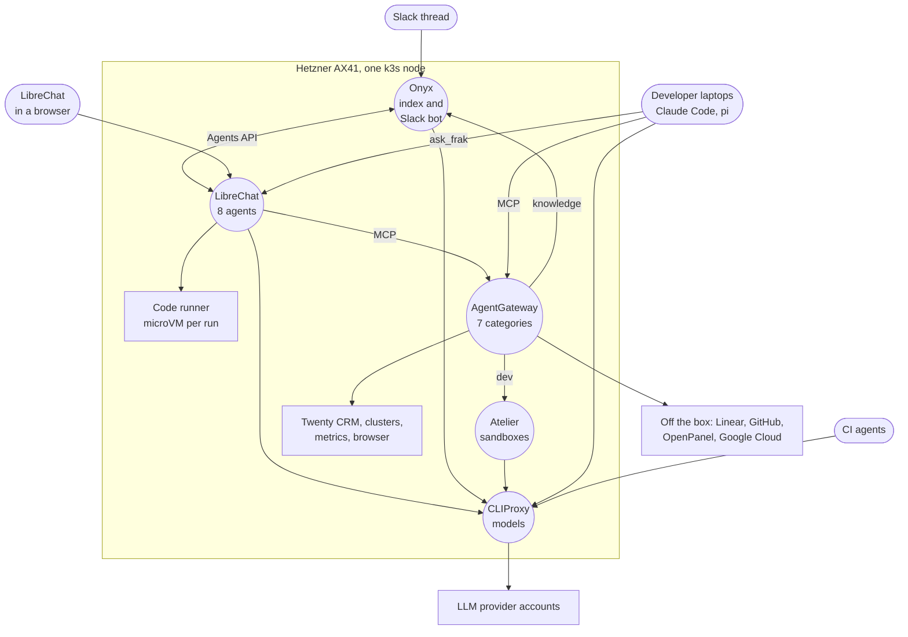
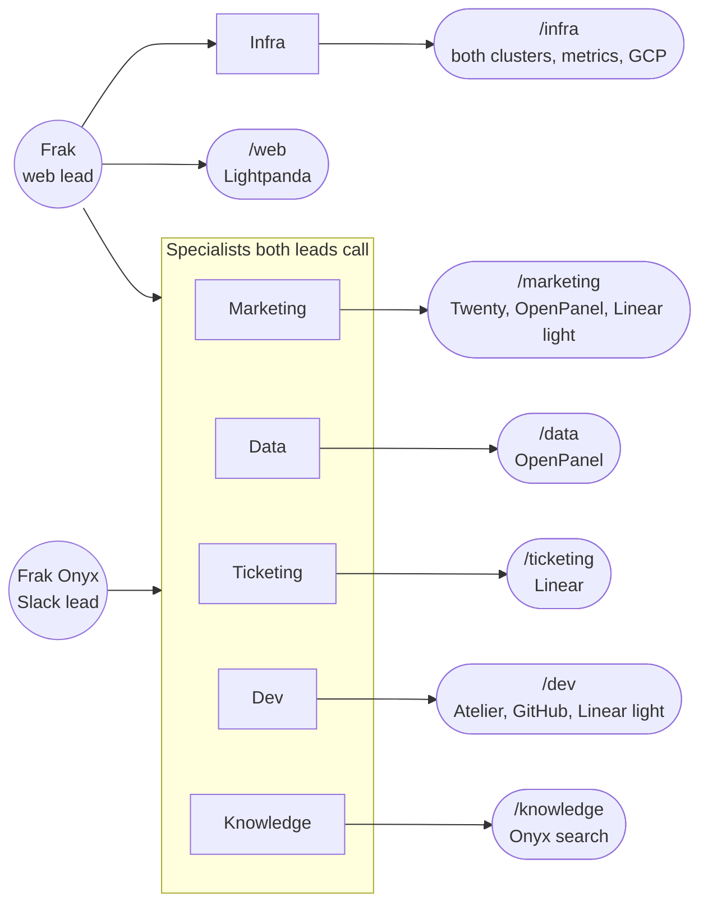
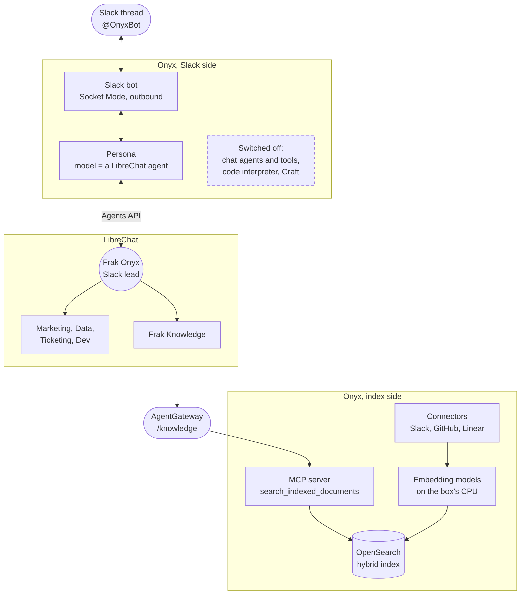
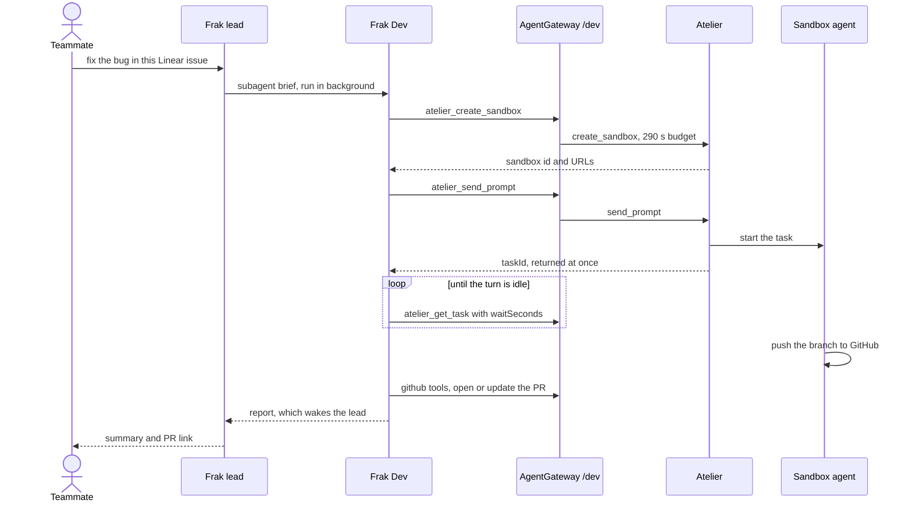

As of 14 October 2026, anyone at Frak can tag OnyxBot in a Slack thread, open LibreChat in a browser, or let their coding agent call `ask_frak` from a pi session, and reach the same team of agents. They read our CRM, our product analytics, Linear and GitHub. They check both Kubernetes clusters, open and render public web pages, and search everything the team has written in Slack, GitHub and Linear. When a request needs a code change, they hand it to an [Atelier](/articles/atelier/atelier-stop-babysitting/) sandbox, where a coding agent does the work.

All of it runs on one Hetzner AX41: a Ryzen 5 3600 with 6 cores, 12 threads and 64 GB of RAM, for about €40 a month. The AI pieces share that k3s node with our [GitHub Actions runners, BuildKit and package caches](/articles/frak/frak-hetzner-platform/), the Atelier sandboxes and a Twenty CRM. Over the 24 hours before I wrote this, the AI stack used 10.2 GiB of memory on average, about a sixth of the box.

Nothing in it is billed per seat. Every component is open source and self-hosted, so the bill has two lines: the server, shared with everything else on it, and the model tokens that go through CLIProxy. It is the habit behind our [on-chain indexing stack](/articles/frak/cost-effective-infra/), whose bootstrap version ran eRPC and Ponder on free tiers. The rule carries over: when the software is open source and we host it, compute is the only cost.

The stack took under six days, from an Onyx and LibreChat experiment on the morning of 8 October to the pi extension just after midnight on the 14th: 31 commits under `infra/hetzner` in our infra-core repository.

## The Map



Five services carry the load, one job each:

| Piece | Job | Called by |
|---|---|---|
| CLIProxy | the single model endpoint | LibreChat, Onyx, Atelier, developer laptops, CI agents |
| AgentGateway | the single MCP endpoint, split into seven categories | LibreChat agents, developer CLIs, Atelier sandboxes |
| LibreChat | eight agents, the chat UI, code execution | the team in a browser, Onyx, developers' pi sessions |
| Onyx | the knowledge index and the Slack front | Slack, the gateway's `knowledge` category |
| Atelier | sandboxes where coding agents take large jobs | the gateway's `dev` category |

Two loops are easy to miss in the diagram. Onyx sits at both ends of a Slack conversation: OnyxBot takes the question and hands it to a LibreChat agent, and that agent searches Onyx's index back through the gateway. Atelier has the same shape with models: the Dev agent launches a sandbox through the gateway, and the coding agent inside the sandbox calls CLIProxy for its own model.

## What It Costs

### Licences

| Piece | Version | Licence |
|---|---|---|
| [LibreChat](https://github.com/danny-avila/LibreChat) | v0.8.8 | MIT |
| [Onyx](https://github.com/onyx-dot-app/onyx) | v4.9.0 | MIT, except its `ee` directories, which we do not use |
| [agentgateway](https://github.com/agentgateway/agentgateway) | v1.6.0 | Apache-2.0 |
| [CLIProxyAPI](https://github.com/router-for-me/CLIProxyAPI) | `latest`, pulled nightly | MIT |
| [LibreChat code interpreter](https://github.com/LibreChat-AI/code-interpreter) | v1.10.3 | Apache-2.0 |
| [Lightpanda](https://github.com/lightpanda-io/browser) | 1.0.0 | AGPL-3.0 |
| kubernetes-mcp-server, mcp-grafana, mcp-victoriametrics | | Apache-2.0 |
| [LibreChat admin panel](https://github.com/ClickHouse/librechat-admin-panel) | pinned commit | AGPL-3.0 |
| [Atelier](https://github.com/frak-id/atelier) | v2 | MIT, ours |

Web search in LibreChat goes through Keenable, whose public endpoint needs no key and is rate-limited per IP, and with `rerankerType: none` the whole web-search chain runs keyless. Twenty CRM runs on the same box and OpenPanel on our GKE cluster. Linear and GitHub are reached through their hosted MCP servers, with tokens from accounts the team already had.

### Memory and CPU

These figures come from VictoriaMetrics on the box: container working set, over the 24 hours ending at 22:50 UTC on 13 October.

| Piece | Pods | Average memory | Peak memory |
|---|---|---|---|
| Onyx | 18 | 8.5 GiB | 9.1 GiB |
| LibreChat, MongoDB, Meilisearch, admin panel | 4 | 0.8 GiB | 1.1 GiB |
| Code runner | 8 | 0.6 GiB | 0.7 GiB |
| Lightpanda browser | 1 | 80 MiB | 1.2 GiB |
| VictoriaMetrics, exporters, its MCP server | 4 | 130 MiB | 210 MiB |
| CLIProxy | 1 | 80 MiB | 190 MiB |
| Kubernetes and Grafana MCP servers | 2 | 60 MiB | 70 MiB |
| AgentGateway | 1 | 16 MiB | 20 MiB |
| **Total** | **39** | **10.2 GiB** | **11.2 GiB** |

The whole stack averaged 0.37 CPU cores. Onyx took 0.22 of that, with a 5-minute peak of 3.3 cores. Everything else averages 1.7 GiB of memory.

The node itself has 62.7 GiB. Over the same window it used 27.5 GiB on average and 35.7 GiB at peak, Atelier's VMs included, and its CPUs averaged 1.2 busy cores out of 12. When I took the snapshot, the largest neighbours were four Atelier sandboxes at 11 GiB, BuildKit at 4 GiB and Twenty at 1.6 GiB.

The resource that runs out first is requests. The pods on the node request 10.5 of the 12 CPUs (87%) and 46 GiB of memory (73%), while measured CPU use averages a tenth of the box. Kubernetes schedules on requests, so a chart with generous defaults fails to schedule long before the hardware is busy. Onyx's chart asks for about 9.5 CPUs as shipped. It did not fit until I cut its requests to about 3.1 CPUs and 15 GiB, starting from the "small" tier of upstream's sizing guide and going lower. Limits go the other way: they add up to 579% of the CPU and 186% of the memory, so an Onyx indexing run, a code execution and a sandbox build at the same moment can still push the host into memory pressure. The host has OOM-killed Atelier's Kata sandboxes before, and the [runtime-rs article](/articles/atelier/atelier-kata-runtime-rs/) covers that.

## CLIProxy: One Model Endpoint

[CLIProxy](https://github.com/router-for-me/CLIProxyAPI) is an OpenAI-compatible proxy in front of the team's model provider accounts. It started as one component of Atelier's first Helm chart, [described in the Atelier infrastructure article](/articles/atelier/atelier-supporting-infrastructure/), and it is the only part of that chart still running.

Every model call in this article goes through it. LibreChat and Onyx reach it inside the cluster at `atelier-cliproxy.atelier-system.svc:8317/v1`. Atelier v2 uses its public hostname. Developer laptops point their coding CLIs at it, and so does the [weekly dependency-report agent](/articles/frak/llm-dependency-report/) in CI. Each consumer gets its own API key. For LibreChat and Onyx, Pulumi generates it and I register it once in CLIProxy's management UI, so cutting off one app is one line in CLIProxy's config.

CLIProxy outlived its chart because of one annotation. When I decommissioned Atelier v1, `helm uninstall atelier` deleted the CLIProxy Deployment, Service, ConfigMap, Ingress and Secret with everything else. Two objects carried `helm.sh/resource-policy: keep` and survived: the namespace and the data volume. The volume holds the OAuth credentials of every provider account, plus a `config.yaml` that was seeded once and has diverged since, with every issued API key and the model alias tables. infra-core now recreates everything around that volume and refers to it by name only. It is deliberately not a Pulumi resource, so nothing in the program can delete it.

Upstream publishes no useful semver tags, so the image runs on `:latest` with `imagePullPolicy: Always`, and a CronJob restarts it at 02:00 UTC every night to pull the newest build. The kubectl image is distroless, with no shell to chain commands, so the Job is two containers:

```typescript
// infra/hetzner/cliproxy.ts (trimmed)
initContainers: [
    kubectlContainer("restart", ["rollout", "restart", `deployment/${deploymentName}`]),
],
containers: [
    kubectlContainer("wait", [
        "rollout", "status", `deployment/${deploymentName}`, "--timeout=5m",
    ]),
],
```

A new image that fails to pull or start fails the Job, which keeps the failure visible in `kube_job_failed`. The Job's Role can patch that one Deployment and nothing else.

CLIProxy averages 80 MiB, and its limit is still 2 GiB. On 28 September it OOM-looped at 512 MiB: agent sessions send request bodies of 10 to 25 MB, mostly base64 screenshots in the history, with several subagents in flight and each body held in memory more than once.

## AgentGateway: One Door for Every MCP Tool

Before 9 October, every client held its own copy of every upstream token and its own idea of which tools to expose. Onyx attached tools per persona, and a developer setting up Claude Code needed one token per service. [agentgateway](https://agentgateway.dev), a Linux Foundation project, now holds those tokens once. It runs in standalone mode as a single pod and serves one MCP endpoint per kind of agent, `https://mcp.<domain>/<category>/mcp`, each opened by its own key.

| Category | Upstreams | Tools exposed |
|---|---|---|
| `marketing` | Twenty CRM, OpenPanel, Linear | all of Twenty and OpenPanel, Linear "light" (22) |
| `data` | OpenPanel | all, read-only analytics and search-console data |
| `ticketing` | Linear | 38 |
| `knowledge` | Onyx | 1, `search_indexed_documents` |
| `infra` | Kubernetes (both clusters), VictoriaMetrics, Grafana, Google Cloud Logging and Monitoring | 38, read-only |
| `web` | Lightpanda headless browser | 14 |
| `dev` | Atelier, GitHub, Linear | all of Atelier, 10 GitHub patterns, Linear "light" (22) |

The exposure lives in one TypeScript file. An upstream mapped to `{}` exposes everything, and an `allow` list exposes only what it names, with a trailing `*` for prefixes:

```typescript
// infra/hetzner/tools/agentgateway-config.ts (excerpt)
knowledge: {
    description: "Search over what Onyx indexed (Slack, GitHub, Linear)",
    servers: { onyx: { allow: ["search_indexed_documents"] } },
},
dev: {
    description: "Atelier sandboxes + GitHub + light ticketing",
    servers: {
        atelier: {},
        // The sandbox agent clones and pushes on its own, so the
        // orchestrating agent only needs to read GitHub and talk to PRs
        // and issues.
        github: {
            allow: [
                "get_*", "list_*", "search_*", "issue_read", "pull_request_read",
                "issue_write", "add_issue_comment", "create_branch",
                "create_pull_request", "update_pull_request",
            ],
        },
        linear: linearLight,
    },
},
```

A tool missing from an allow list stays hidden, so a tool an upstream adds next month is invisible until someone lists it. That keeps each category's tool count, and with it every agent's context, under control. Linear's MCP server has 65 tools. 27 of them had already been switched off in Onyx, so the full `ticketing` set is the other 38. The "light" set that Marketing and Dev get is the reads plus `save_issue` and `save_comment`, 22 in all.

The file imports nothing from Pulumi. It renders the gateway's config: per category, an API-key policy that stores only the SHA-256 of the key, and per upstream, one CEL rule.

```text
mcp.tool.target == "github" && (mcp.tool.name in ["issue_read", ...] || mcp.tool.name.startsWith("get_") || ...)
```

They are allow rules on purpose: agentgateway's docs warn that a deny expression which errors fails open. Since the renderer is pure, I check a config change before deploying by running the real image on it with `--validate-only`, which rejects unknown fields. The gateway's web UI runs with `storage.mode: readOnly`. It shows the effective config and works as a playground for calling tools, and Pulumi stays the only writer.

The gateway authenticates to its upstreams in three ways. SaaS and app tokens are files mounted from a Secret. The in-cluster read-only servers (Kubernetes, VictoriaMetrics, Lightpanda) have no auth of their own, and a NetworkPolicy lets only the gateway pods in. Google's hosted Logging and Monitoring MCP servers get a short-lived access token the gateway mints itself through Workload Identity Federation: the pod's projected ServiceAccount token is exchanged at Google STS, and the result impersonates a service account that only holds viewer roles. No Google key file exists anywhere.

For a developer, setup is one URL and one key per category:

```bash
claude mcp add --transport http frak-dev https://mcp.<domain>/dev/mcp \
  --header "Authorization: Bearer $FRAK_GATEWAY_KEY_DEV"
```

A key opens its own category and no other: the marketing key gets a 401 on `/dev`. Tool names keep the upstream's prefix in every category (`github_get_file_contents`), so a prompt written against one category works in another.

The price of one door is one identity per upstream. Linear sees one token, whoever asked. Onyx's MCP server filters search results by the owner of the token, so its key is a non-admin one: every caller of `knowledge` reads what that one account can read, and a connector restricted to a group stays invisible to all of them. Twenty fronts its real API with three meta-tools (`get_tool_catalog`, `learn_tools`, `execute_tool`), and the gateway can only filter by tool name, so the Twenty API key's role is what bounds the agents there.

Four gateway behaviours cost me time:

- agentgateway v1.6.0 caps a call to an upstream at 10 seconds unless the target sets `policies.http.requestTimeout`. Atelier's `send_prompt` and `get_task` died at exactly 10.0 s on 13 October, although LibreChat gives the `dev` server 300 s. Atelier now gets 290 s and Lightpanda 100 s. Keeping them under LibreChat's timeout makes the gateway's error the one that surfaces.
- `failureMode: failOpen` skips an upstream that errors and keeps serving the rest of the category. The skip lasts for the whole client session, and LibreChat keeps one long-lived session per server. An upstream that was down when LibreChat connected stays missing for every agent until LibreChat restarts, and nothing errors: the agents just have fewer tools. The only trace is `upstream '<name>' failed during fanout, skipping` in the gateway log.
- Lightpanda answers 403 to any `Host` that is not an IP literal or `localhost:<port>`, a DNS-rebinding guard. The gateway forwards the client's `Host` to a target given by IP and rewrites it for a target given by name. So Lightpanda's upstream URL is its Service ClusterIP, plus a `host: localhost:9223` header override.
- A failed STS exchange is sticky in v1.6.0. After fixing the IAM side, the pod needs a restart.

The gateway uses 16 MiB of memory.

## LibreChat: Eight Agents

The first plan was a benchmark: Open WebUI (running on the box since May), LibreChat and Onyx, all against the same CLIProxy backend. Open WebUI was switched off on 9 October, and LibreChat kept the chat. Its agent features decided it. An agent can call other agents as subagents and detach them in the background, agents can be shared with the whole team, rarely used tools can stay unloaded until a `tool_search` finds them, MCP servers attach per agent, and an OpenAI-compatible Agents API accepts an agent id as the `model`. That last one is how Onyx's Slack bot talks to it.

There are two leads and six specialists, all on `claude-sonnet-5-5` through CLIProxy:



The leads hold almost no tools. Besides `web_search`, the browser, `ask_user_question` and a sandboxed shell, the `Frak` lead's only tool is `subagent`. Each specialist holds one gateway category plus the browser, `web_search` and code execution, and returns a short report that the lead relays. Frak Infra's, for example, opens on a one-line verdict, then lists Evidence, Caveats and Not done, in about 250 words. Tools a specialist rarely needs are deferred. Infra loads 10 of its 38 up front and finds the other 28 through `tool_search`, and every browser tool starts deferred.

Each prompt also states what the agent cannot do. This is Frak Infra's:

```text
You cannot change anything: no restart, scale, delete, apply, silence or
rollback exists in your tools. If asked to, say so in one sentence, give the
read-only diagnosis, and put the exact command a human would run under Not
done, marked as a suggestion.
```

Frak Onyx, the Slack lead, has neither Infra nor the browser. Logs can carry personal data and credentials, so Infra stays in the web chat.

Agents and their prompts are data in LibreChat's MongoDB, outside infra-core's Pulumi code. The prompts that matter are copied into `docs/agents/*.md` in infra-core, as the source to rebuild an agent from. Per-tool flags are set on every agent by `scripts/librechat-tool-options.ts`, which runs `mongosh` inside the MongoDB pod so the credentials never leave it.

### The settings that took the most work

| Setting | Value | Why |
|---|---|---|
| `ALLOW_REGISTRATION` | `false` from the first boot | Every account spends the team's model quota. Accounts come from `npm run create-user`, and the first one becomes admin |
| `max_tokens`, per agent | 128000 | CLIProxy sends Claude `max_tokens: 32000` when the client sets none. A tool call cut at that limit was dropped silently: the lead announced a delegation and never made it |
| `recursion_limit`, per agent | 150 | A subagent runs `floor(limit/3)*3` graph steps. 40 meant 39 steps, about 13 tool rounds |
| `maxToolCallArgBytesByTool` | 128 KiB for `subagent` and the Linear save tools | The agents SDK aborts a run when a streamed tool-call argument passes 64 KiB. The lead could not hand a 105 KB audit to Ticketing |
| activity, phase and reasoning labels | on, with `activityModel: claude-haiku-5-5` | Runs become readable while they happen. Each label is an extra call, and without `activityModel` it falls back to the run's own Sonnet or Opus |
| `capabilities` | the 14 defaults, plus `run_in_background` and `tool_intents` | Setting the key replaces the default list, so the defaults are repeated |
| `fileSharing` | off | In v0.8.8, a run whose root agent shares files keeps every subagent in the foreground, and detaching specialists is the lead's main job |
| `interface.modelSelect`, `presets`, `parameters` | `true`, spelled out | They default to `false` as soon as `modelSpecs.list` is non-empty, which left the picker with one spec and no agents |
| `interface.agents` | `create`, `share`, `public` spelled out | Written to the roles at startup only when the key is present. A removed `create: false` stayed in the DB and made agent edits return 403, even for the admin |

The MCP servers are declared in `librechat.yaml`, not through the UI. Servers made in the UI cannot set a timeout, cannot read `${ENV}` keys, and keep their key in MongoDB. The YAML block is generated by `librechatMcpServers()` from the same file as the gateway config, so a new category shows up in both at once. LibreChat blocks `*.svc.cluster.local` as an SSRF target, so it reaches the gateway through the public hostname. The `web` server sends an `X-Frak-User: {{LIBRECHAT_USER_ID}}` header. Nothing reads that header, but a user placeholder makes LibreChat open one connection per user, which gives every user their own browser session.

`execute_code` runs on LibreChat's open-source code interpreter, deployed next to it. Each execution boots a libkrun microVM, with a 60-second cap and no network. The pod is not privileged: a device plugin hands it `/dev/kvm`, and LibreChat signs a short-lived EdDSA token per user that the runner verifies. Two details there are easy to miss. The tool reaches the model as `bash_tool` and `read_file`, so a prompt that says `execute_code` makes the model waste a `tool_search` looking for it. And LibreChat v0.8.8 re-uploads every code file on every turn, which tripped the runner's limit of 30 uploads per 5 minutes and showed users "Some files from this conversation could not be restored". The limit is 600 now.

LibreChat runs without its RAG API, because file search needs an embeddings endpoint and CLIProxy serves none, so search over the team's knowledge comes from Onyx.

The browser came in on 13 October, after a failed request. Someone asked for the exhibitor list of a trade show, and the lead could only run a web search: `web_search` cannot open a URL, and the page is an empty `<div>` until JavaScript loads 878 exhibitors. With Lightpanda in the `web` category, the lead loads the list, starts a background `evaluate` job that fetches the 878 detail pages in about 15 seconds, and passes the CSV to the shell by reference instead of retyping it. A Lightpanda page keeps every document it parsed until it navigates away, 334 MiB after that job against 33 MiB after `about:blank`. So every prompt ends a browsing session on `about:blank`, and a CronJob restarts the browser every night.

## Onyx: The Index and the Slack Front

[Onyx](https://onyx.app) went in on 8 October as a full platform: chat, agents with about 100 MCP tools, connectors and the Slack bot. On the morning of 9 October I switched on its code interpreter and Craft, its per-user app sandboxes. By 17:43 that day both were off again, and Onyx had a narrower job.

LibreChat's agent feature set is much larger: subagents, background runs, agents the whole team can share and export, an Agents API. Onyx is better at what LibreChat does not do at all. Its connectors keep an index of Slack, GitHub and Linear current. It runs hybrid search over OpenSearch with its own embedding model servers on the box's CPU, so indexing calls no API. And it ships a Slack bot. So Onyx keeps the index, the search, the Slack bot and an MCP server for search, and everything else is off.



The handoff is an LLM provider in Onyx's admin settings: an OpenAI-compatible provider whose base URL is LibreChat's `/api/agents/v1`, and whose model is the id of the Frak Onyx agent. OnyxBot answers with a persona pinned to that model. Onyx keeps the Slack side: the Socket Mode connection, threads, and an Onyx account created from the sender's Slack email on first use. LibreChat does the work.

That bridge has two weak spots. The persona streams nothing while the lead's specialists work, which takes 10 to 30 seconds typically and over 70 for a slow CRM query or a cold sandbox boot. Onyx's default stall timeout between two streamed packets is 60 seconds, so `LLM_SOCKET_READ_TIMEOUT` is 180. The second is quieter. The bridge is one LibreChat Agents API key stored in Onyx, and on 9 October it disappeared for a reason I never found. It had no expiry set. Slack answers came back empty with an HTTP 200, no error anywhere. The check now is a `GET <api_base>/models` with the stored key, where a 401 means recreate it.

Onyx's Helm chart bundles ingress-nginx, a CNPG operator, a Redis operator and MinIO. All four are off here:

- Traefik's Gateway is the only entry point on the box, so an HTTPRoute reproduces the chart's nginx rules, with prefix strips for `/api` and `/mcp`.
- The cluster's CNPG operator reconciles Onyx's Postgres. A second copy of the operator fights over the cluster-scoped CRDs. Onyx still gets its own Postgres cluster: it opens a connection pool per Celery worker and would eat the 100 connections the other apps share.
- A dedicated Valkey replaces the Redis operator. Onyx hardcodes logical databases 0, 14 and 15, and database 0 on the shared Valkey already belongs to another app.
- SeaweedFS replaces MinIO as the object store.

Onyx is still the heaviest piece of the stack: 18 pods and 8.5 GiB, with OpenSearch at 2.5 GiB and the indexing model server at 1.7 GiB. The index itself takes 70 MB on disk.

Sign-up needs care. Onyx accepts sign-ups from `VALID_EMAIL_DOMAINS` until an admin turns on invite-only, a setting stored in the database with no environment variable, and the first account becomes admin. So the admin registers right after the deploy. The allowed domains include `frak-labs.com` because OnyxBot creates accounts from Slack emails, and ours are on that domain.

## Atelier: Where the Large Coding Jobs Go

Frak Dev holds the `dev` category: Atelier's 14 tools, a read-mostly GitHub and light Linear. Atelier's MCP server covers the sandbox lifecycle (`create_sandbox`, `sandbox_lifecycle` for pause and resume, `exec`, `patch_files`, `expose_port`, prebuilds and toolboxes) and the coding agent inside it (`send_prompt`, `get_task`, `manage_task`). LibreChat suffixes MCP tools with their server name, so the model sees them as `atelier_send_prompt_mcp_dev`.



`send_prompt` returns at once with a task id. `get_task` then long-polls with `waitSeconds`, so Frak Dev waits on the server instead of looping. Tasks live in Atelier's memory and close after an hour without activity. Because a sandbox boots from a [content-addressed prebuild](/articles/atelier/atelier-prebuilds/), the repository is already cloned and its dependencies installed when the coding agent gets the prompt. LibreChat gives the `dev` server 300 seconds per call (its default of 60 is too short for sandbox boots, prebuild bakes and resumes), and the gateway gives Atelier 290.

The GitHub allow-list follows from who does what. The coding agent inside the sandbox clones and pushes on its own, so the orchestrating agent only needs to read GitHub and talk to issues and PRs. Pushing files, merging, deleting, creating or forking repositories, and reviews are not exposed.

In March, Atelier had a dispatcher of its own behind a [Slack bot and an MCP server](/articles/atelier/atelier-slack-mcp/). In this stack the same MCP server is one upstream among twelve, and a Slack request reaches it through OnyxBot, the Frak Onyx lead and Frak Dev. Atelier resolves each bearer token to a user, but behind the gateway every agent-launched sandbox belongs to the one token the gateway holds. That also makes Atelier's limit of 20 open tasks per user a limit for all the agents together.

## From a Coding Session: ask_frak

The last entry point went in just after midnight on 14 October. `devtools/pi` in infra-core is a [pi](https://pi.dev) package, never deployed, whose `ask_frak` tool lets the model in a developer's pi session consult the Frak agents. The local model keeps the code. Frak brings what the laptop does not have: tickets, PR and CI state, cluster health, analytics, the CRM and team knowledge. The tool calls the same OpenAI-compatible Agents API that Onyx uses for Slack, streaming `/api/agents/v1/chat/completions` with an agent id as the `model`.

Setup is one key and one install:

```bash
# Personal key: LibreChat, Settings, Data & Privacy, Agent API keys
export FRAK_AGENTS_API_KEY=...
pi install <infra-core checkout>/devtools/pi
```

Then `/frak-agents` in pi lists the agents the key can reach.

The call runs as the developer. Until that night, calling the Agents API meant borrowing the admin-owned key that Onyx uses. `interface.remoteAgents` in `librechat.yaml` now lets every user mint a personal key, and each call passes three gates. The extension turns each failure into the name of the gate:

| Answer | Gate that failed |
|---|---|
| 401 | the key is wrong, expired or deleted |
| 403 `Insufficient permissions` | the user's role may not use the Agents API. `remoteAgents.use` is checked on every request, so turning it off kills existing keys |
| 403 `No remote access to agent` | the agent is not shared with that user for remote access, an ACL separate from the share that shows it in the chat |

The third gate fails quietly. Over the API, the lead loads only the specialists the caller can reach remotely and skips the others without a word, so a developer granted remote access on the lead alone gets a lead with no specialists at all. The grant goes on all seven agents. `remoteAgents` also sets only `use` and `create`. `share` and `public` would be written to the ADMIN role as well, the same trap as `interface.agents`, and a `false` there would stop the admin granting remote access at all.

Two behaviours differ from the web chat. The API keeps no conversation, so `follow_up: true` resends the earlier briefs and answers of the current pi session branch, up to 10 exchanges. And an API caller gets exactly one reply, while the web lead's habit is to detach its specialists and answer when they wake it. So every brief starts with a note for the lead:

```text
[Sent by a developer's coding agent through the Agents API. This reply is the
only one that reaches them: wait for every specialist you brief and put the
results in this answer, since anything still running in the background is
lost. You cannot see their machine, repository or conversation, only this
brief.]
```

Frak never sees the laptop, so the tool's description asks the local model for a self-contained brief, with the error, the code or the file excerpt pasted in. Esc in pi also cancels the run in LibreChat, and a run is capped at 20 minutes. Only text comes back: a chart or file the code runner writes stays in LibreChat.

The first three calls came from a pi session in infra-core on the night it shipped. The lead answered a health check of the Hetzner box in 70 seconds, flagging a root disk above the kubelet's image garbage-collection threshold. Frak Data returned 28 days of daily sign-ups from OpenPanel as CSV in 41 seconds, then the same analysis computed in the code runner in 45.

## Links

- [LibreChat](https://www.librechat.ai) and its [code interpreter](https://github.com/LibreChat-AI/code-interpreter)
- [Onyx](https://onyx.app)
- [agentgateway](https://agentgateway.dev)
- [CLIProxyAPI](https://github.com/router-for-me/CLIProxyAPI)
- [Lightpanda](https://lightpanda.io)
- [Keenable](https://docs.keenable.ai/integrations/librechat)
- [kubernetes-mcp-server](https://github.com/containers/kubernetes-mcp-server), [mcp-grafana](https://github.com/grafana/mcp-grafana), [mcp-victoriametrics](https://github.com/VictoriaMetrics-Community/mcp-victoriametrics)
- [L'Atelier on GitHub](https://github.com/frak-id/atelier)
